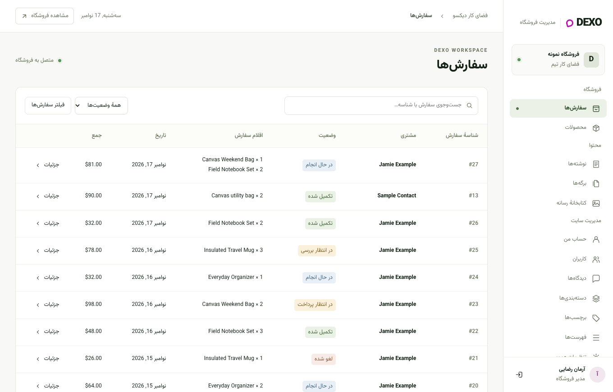
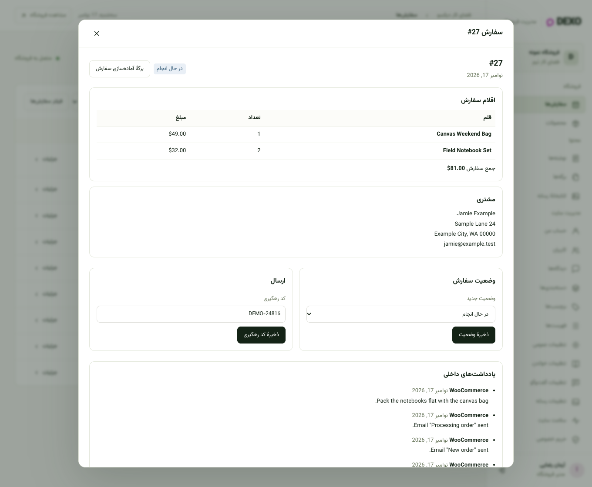
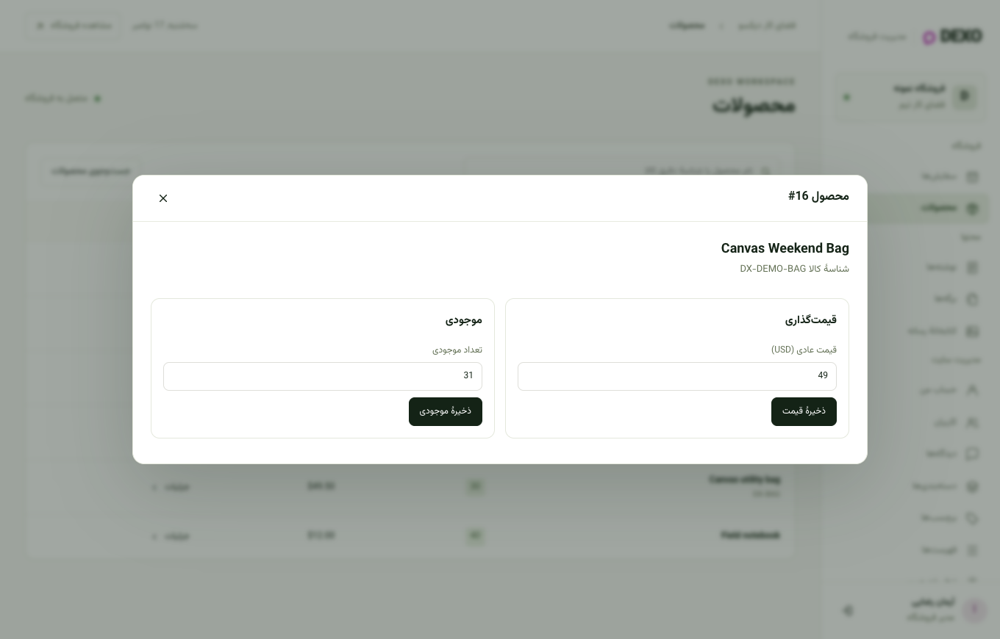
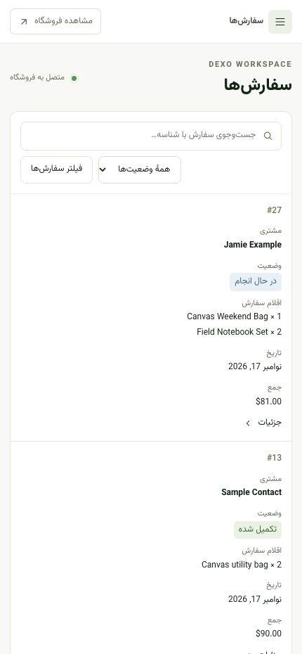
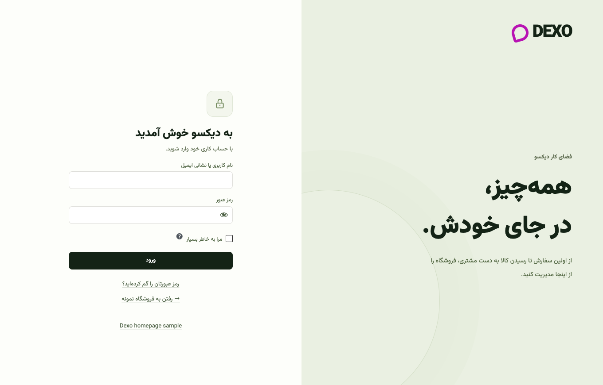
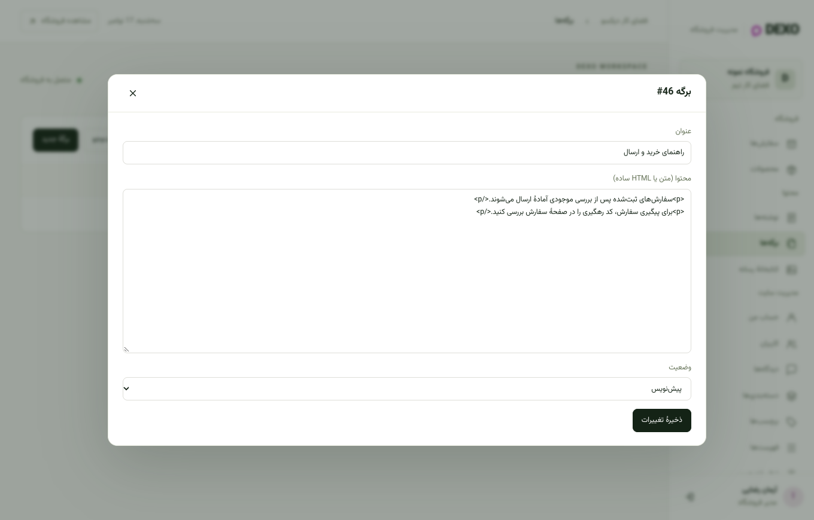
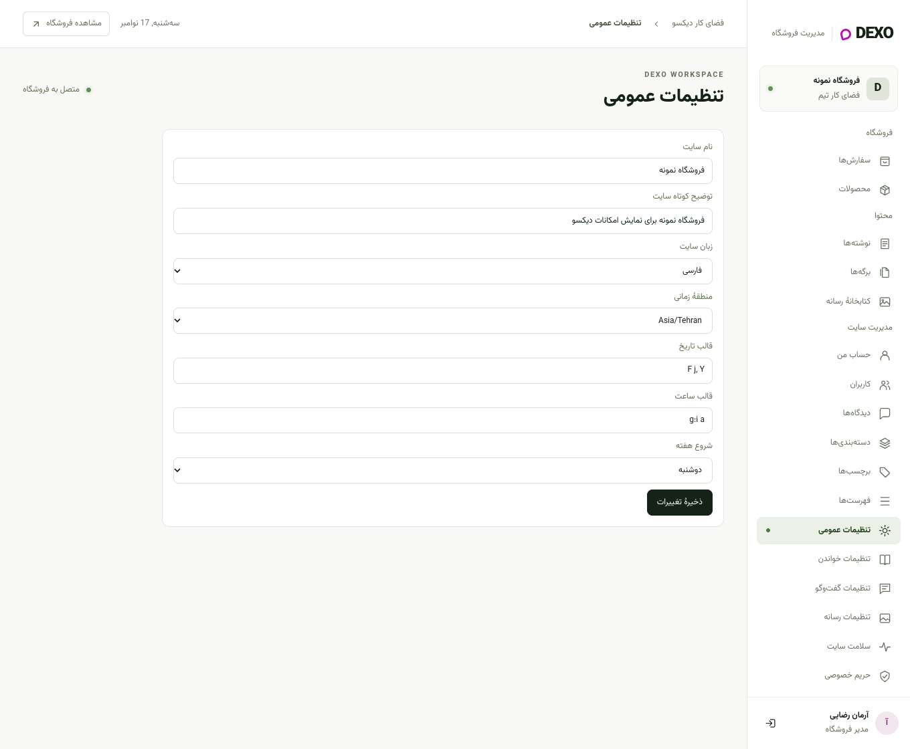
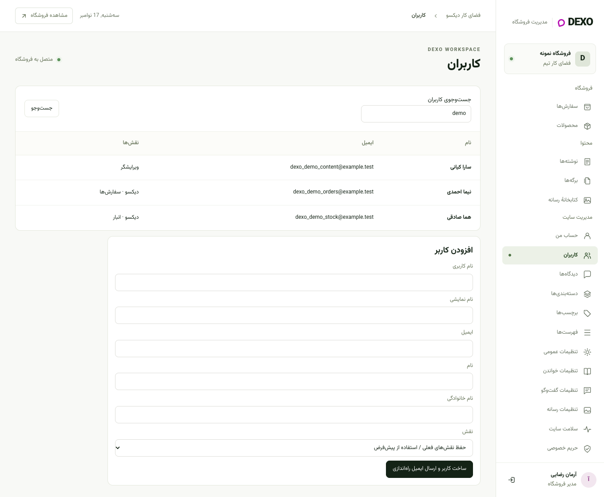

# Dexo

Dexo is a standalone operations dashboard for stores using WooCommerce. It runs on your existing WordPress site at `/dexo/` and uses the store’s WordPress accounts. It includes English and Persian interfaces.

[راهنمای فارسی](docs/install-fa.md) · [Downloads](https://github.com/masedghi/dexo/releases) · [Extend Dexo](docs/develop.md) · [Design](DESIGN.md)

## Screenshots

Captured from Dexo running on a demo WooCommerce store with sample data.

Order details and shipment tracking

Product price and inventory

Persian mobile dashboard · نمای فارسی موبایل

Staff sign-in

Posts, pages, and media

Site settings and user management

## What you can do

- Find orders by their internal ID or browse by status. Open order items, update standard WooCommerce statuses, add private notes, record a tracking code, and print a packing slip.
- Search products by name or exact SKU. Update regular prices, stock counts, and stock availability for supported products. Edit individual variations, or manage inherited inventory on their parent product.
- Create and edit posts and pages using text or basic HTML, and upload images or PDFs. Existing block-based content links to the WordPress editor to preserve its structure.
- Manage site title, tagline, installed language, timezone, reading, discussion and image-size settings.
- Search and manage users, assign permitted roles, send setup and password-reset emails, and update your own account with email confirmation.
- Moderate and reply to comments, manage post categories and tags, and build classic or block navigation menus with nested links.
- Review site health, choose a privacy policy page, and process confirmed WordPress personal-data export and erasure requests through registered plugin callbacks.
- Give team members a dedicated orders, warehouse, or catalog role. Each role sees only its Dexo screens and the fields it needs. Content sections follow the existing WordPress capabilities of Administrators, Editors, Authors, and other roles.

Product creation, discounts, refunds, shipping integrations, and bulk changes are outside the scope of this release. Changes to orders invoke WooCommerce’s normal status hooks and may trigger its stock or notification workflows.

## Install

1. Use a staging site with WordPress 6.8 or newer, PHP 8.1 or newer with `mbstring`, and WooCommerce active. This release was verified on WordPress 7.1, WooCommerce 11.1.0, PHP 8.5, MariaDB, and Twenty Twenty-Five. Test your store’s versions and plugins before rollout. Single-site WordPress is the supported setup for this release.
2. Download **`dexo-0.4.0.zip`** from the [v0.4.0 release](https://github.com/masedghi/dexo/releases/tag/v0.4.0). Use the named ZIP under Assets.
3. In WordPress, open **Plugins → Add Plugin → Upload Plugin**. Upload the ZIP and activate **Dexo**. The Plugins list has an **Open Dexo** link.
4. Open `https://your-store.example/dexo/`. With plain permalinks, use `https://your-store.example/?dexo=1` instead. Reserve the `dexo` path for the dashboard and exclude the dashboard and sign-in from any full-page cache or CDN page caching. If the store lives in a subdirectory, use **Open Dexo** to get its URL.
5. In **Users**, create a separate account for each employee and assign its Dexo role. Share the **Open Dexo** URL with staff. Test each role using its own account.

| Role | Day-to-day access |
| --- | --- |
| **Dexo · Orders** | Orders, standard status changes, customer details, totals, private notes, shipment tracking and packing slip |
| **Dexo · Warehouse** | Order items and packing slips, tracking, product lookup, and inventory. Customer contact details, order amounts, and product prices are restricted. |
| **Dexo · Catalog** | Product lookup, regular price and stock edits. |
| **WordPress Administrator / WooCommerce Shop Manager** | Commerce functions and the content permissions their existing WordPress roles grant. |
| **WordPress Editor / Author** | Content and moderation capabilities supplied by WordPress. Authors access their own content. |
| **All accounts with the WordPress read capability** | Their own Dexo account page. Other sections follow their existing capabilities. |

Staff sign in through the Dexo-styled WordPress login. Use the Dexo URL as the team entry point. Accounts that also carry other WordPress roles keep the capabilities that those roles grant. Authentication extensions and account recovery screens are controlled by the site’s login stack. Verify any SSO, CAPTCHA or two-factor plugin in staging.

## Update or remove

Use **Plugins → Add Plugin → Upload Plugin** to install a newer Dexo ZIP, and choose **Replace current with uploaded**. Test updates in staging first. Keep the previous release ZIP available to reinstall if necessary.

Disable Dexo from **Plugins** to stop serving the dashboard and end its redirects. WooCommerce changes already saved, Dexo role assignments, and tracking values are retained. Reassign dedicated staff before removing Dexo if they need a different role afterward.

## Development

Dexo uses PHP, CSS, and a small print script. The package is ready to run on PHP. The [developer guide](docs/develop.md) covers extension hooks, local integration tests, and building the ZIP. [Report a security issue privately](SECURITY.md).

Content creation currently uses text or basic HTML. Existing block-based or custom-markup content opens in the WordPress editor.

Source code is licensed under [GPL-2.0-or-later](LICENSE).

## Site management

The site-management screens follow native WordPress capabilities. Administrators can manage general, reading, discussion and media settings, user accounts, menus, site health and privacy. Editors can moderate the comments and terms their role permits. The built-in Dexo commerce roles also have access to their own account page.

- Role assignment requires the native promotion capability and an allowed role. An operator cannot change their own role through the user-management form. Accounts with multiple roles retain them unless an allowed replacement is explicitly selected.
- Your own email changes require the current password and a confirmation email. Password changes also require the current password. Sending setup, reset or confirmation links depends on the site's mail service.
- Classic menus support nested items, order and registered theme locations. Block navigation supports standard links and submenus. Use the Site Editor for placement in a block theme or for advanced navigation blocks.
- Privacy requests use WordPress confirmation emails and its registered exporters and erasers, including those supplied by plugins. Erasure follows those plugins' retention rules. The account itself stays available.
- Site Health shows environment details and local WordPress checks, with a link to the complete native health screen for network-dependent checks.
- Image dimensions apply to new uploads, and default discussion settings apply to new posts. The language selector lists languages already installed on the site.
